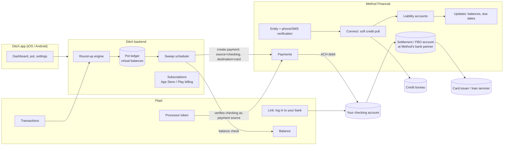

# How Ditch Works: Reverse-Engineering Notes

Research notes on the Ditch app ("Put Debt On Autopilot"), the services behind it, why its data can be wrong, and what that means for this app. No code here, only how things work.

**How sure each claim is:**

- ✅ **Confirmed.** A public source says so: Ditch's site or terms, Method's docs or case study, Plaid's docs, or app-store reviews.
- 🟡 **Likely.** Inferred from vendor docs and how these systems normally work.
- ❓ **Guess.** Plausible, but I couldn't verify it.

---

## 1. TL;DR

- Ditch is a thin app on top of two vendors. **Method Financial** finds your debts and sends the payments. **Plaid** links your checking account and, most likely, supplies the purchases that get rounded up.
- **The "pot" is not real money.** It's a running total in Ditch's database. Nothing leaves your checking account until the total reaches your trigger amount. Then Ditch makes **one** payment that pulls from checking and pays the debt in a single step, and it never holds your money. ✅
- **Why your data looked wrong:** Method finds debts with a **soft credit pull**. Credit-report data is often about a month old, includes closed accounts, and can split one student loan into several entries. Ditch's App Store reviews describe the same problems. ✅
- **Better approach:** use a **hybrid**. Link cards and checking directly with Plaid or Teller, which read straight from the bank and are much fresher. Use the credit report only to *discover* accounts. Handle Nelnet separately: **Plaid dropped federal student loan servicers, Nelnet included.** ✅
- **Money movement is the hard part, not the data.** Ditch can pull from your checking and pay your cards because it's a business with a contract with Method, which brings regulated bank partners. A personal app can't easily do that. See §8.

---

## 2. What Ditch is (known facts)

| Item | Detail | Source |
|---|---|---|
| Company | Atlanta-based. Founder and CEO is Luis Andino. | ✅ Ditch site, Business RadioX, Hypepotamus |
| Launch | Went live October 2023 with a debt dashboard and payments built on Method. Round-ups launched May 2024. | ✅ Method case study, Hypepotamus |
| Scale | About 100 users at launch, about 30,000 now. "$3M+ in debt payments" (Method) vs "$10.1M paid off" (Ditch homepage). | ✅ vendor-reported, not audited |
| Round-up rule | "Round up each transaction amount to the nearest dollar and contribute the difference… Users can also elect to multiply the round-up amount by a chosen factor." | ✅ Ditch terms |
| Trigger | "Funds are only pulled once your round-ups reach the trigger amount you've set (for example $25)." | ✅ Ditch FAQ |
| Overdraft guard | "We always check your account balance before initiating a withdrawal. If there aren't enough funds available, we won't pull money." Users also set a **safe balance**, and payoffs are skipped below it. | ✅ Ditch FAQ and terms |
| Where money goes | **Debt only for now.** "Savings support is something we're exploring." | ✅ Ditch FAQ |
| Pricing | 7-day trial, then Basic $3.99/mo ($25 minimum payment plus a processing fee), Plus $9.99/mo ($10 minimum, no processing fee), Pro $15.99/mo (adds phone support). | ✅ Ditch site |
| Fee | Terms: "up to an 8% fee… applied to each payoff amount… deducted from the payoff amount before it is sent." Reviewers report a $1 minimum fee per payoff. | ✅ Ditch terms, App Store reviews |
| Debt limits | Entry level: up to 3 debt accounts, focusing on one at a time. Which plan this applies to is unclear. | ✅ search summary of Ditch site |
| B2B angle | Employers can **match** employees' debt payments, similar to a 401(k) match. | ✅ Hypepotamus |

> You remembered the default trigger as $20. The public pages use **$25** as the example, and $25 is also the **minimum** on the Basic plan ($10 on Plus). The minimum payment depends on your plan.

---

## 3. The architecture (reconstructed)



### Which service does what

| Job | Who does it | Confidence |
|---|---|---|
| Finding all your debts in one step | Method **Connect** (soft credit pull, matched against 15,000+ institutions) | ✅ case study: "connect all liabilities in a single step" |
| Live balance, due date, minimum payment, APR on each debt | Method **Update / Balance** (direct from the institution when Method has a connection, otherwise falls back to the credit report) | ✅ Method docs |
| Sending money to the creditor | Method **Payments** ("Connect and Pay" are the two products Ditch uses) | ✅ case study |
| Linking checking (the payment source) | Plaid Link, then a **Plaid processor token** handed to Method, which marks the account verified and payable | 🟡 Method supports exactly this flow (Plaid, MX, or Teller tokens, or micro-deposits), and you saw Plaid in Ditch's onboarding |
| Getting purchases to round up | Plaid **Transactions** on the linked checking account and possibly cards | 🟡 Method's card-transaction feed is a possible alternative ❓ |
| Overdraft check before pulling | Plaid **Balance** (live fetch) or Method's balance on the source account | 🟡 |
| Subscriptions | In-app purchase through the app stores | ✅ listing shows in-app purchases |

---

## 4. Step by step: what happens inside Ditch

### 4.1 Onboarding and finding your debts

1. **You enter your name and phone number.** Method creates an **Entity**, which is its record of you.
2. **Phone verification.** Method requires an SMS one-time code before it will look for your accounts. Identity verification is a separate step that can ask for date of birth, address, or the last 4 of your SSN. ✅
3. **Connect.** Method runs a **soft credit pull**, which doesn't affect your score, and matches each credit-report entry to an institution it supports. ✅
4. **Result:** a list of liability accounts such as cards, student loans, and auto loans, **including closed ones**. Method's docs say the first Connect "returns all discovered liabilities (active and closed)." ✅
5. Each account comes with a list of **products** saying what Method can do with it: get live updates, pay it, and so on. Not every debt supports every product, so some appear in the app but can't be paid or can't be refreshed. ✅

This is the "magic moment" Ditch talks about. You never log into each card separately, because it all comes from the credit report.

### 4.2 Linking checking

6. You log into your bank through Plaid Link.
7. Ditch exchanges the Plaid account for a processor token and gives it to Method. Method verifies the account from Plaid's balance and transaction data and fires an "account active" event. Your checking account can now be the **source** of payments. 🟡

### 4.3 The round-up engine

8. Ditch receives new transactions from Plaid, which notifies it when there are updates.
9. For each eligible purchase it computes:

   ```
   round_up   = next whole dollar − amount       ($13.40 → $0.60)
   contribution = round_up × multiplier          (×2 → $1.20)
   pot_total += contribution
   ```

10. Nothing is moved yet. The pot is just a number. ✅ A Google Play reviewer complained that round-ups aren't pulled at purchase time.

### 4.4 The sweep (when the pot hits the trigger)

11. A scheduled job, probably daily, checks each user: is `pot_total ≥ trigger`? 🟡
12. If yes, it checks checking: is the **live balance minus the pot still above your safe balance**? If not, it skips and tries again later. ✅
13. It creates **one Method payment**: source = your checking, destination = the chosen debt, amount = pot minus fee. ✅ The fee rule is in the terms. How the fee is split off is ❓.
14. It resets the pot to zero, or keeps any amount over the trigger. ❓

### 4.5 How the money actually moves (Method's side)

15. Method supports two funding models. ✅
    - **Debit model:** Method pulls from the user's checking by ACH. Cutoff is 1:30 PM Central.
    - **Prefunded / FBO model:** the app keeps a pooled account with Method. Cutoff is 3:30 PM Central.

    Ditch almost certainly uses the **debit model**, because the money comes from your checking. 🟡
16. Money lands briefly in Method's settlement account at its bank partner. Method's FDIC comment letter describes "non-transactional FBO settlement accounts." Method then pays the creditor electronically. ✅
17. **Timing:** "typically 2–3 business days, but creditor posting times vary." Business days only, no bank holidays. ✅
18. Method sends status updates (webhooks) as the payment moves along. Ditch uses them to show "processing" or "paid." 🟡

**Why this is clever:** Ditch never holds your money and never runs a bank account for you. Method and its bank partner carry the regulatory weight. Ditch only stores numbers and tells Method when to pay.

---

## 5. Why your data wasn't accurate

These are mostly how credit-report data works. Ditch's reviews describe the same symptoms.

| Symptom | Root cause |
|---|---|
| **Balances are weeks old** | Method's credit-report data is "only as fresh as the most recent creditor report," and its docs list that as **monthly**. Card issuers usually report once per statement cycle. A payment you made last week may not show until next month's report. ✅ |
| **Closed or paid-off accounts show up** | Connect returns active **and** closed accounts. A reviewer said Ditch's first recommendation was a card "paid off and closed two months back." ✅ |
| **"Incorrect balances"** | Another reviewer saw about $9,999 on two cards that were wrong. This is consistent with statement-date or credit-report balances, or a failed live update. ✅ symptom, 🟡 cause |
| **Student loans split into many entries** | Federal loans are often reported as **one entry per loan, or even per disbursement or loan type**. One Nelnet account can show up as 4–8 "debts." ✅ |
| **Some debts can't be refreshed or paid** | Each account's products list varies. When Method has no direct connection to the lender, it falls back to the credit report. A reviewer said Ditch payments "weren't compatible with my student loans." ✅ |
| **Authorized-user cards or someone else's debt** | Credit reports include cards where you're only an authorized user. ❓ Not seen in reviews, but a common issue with credit-report data. |

**Bottom line:** the credit report is great for **finding** what you owe. It's poor for showing **current balances**. Ditch leans on it for both.

---

## 6. Is there a better way? (data sources compared)

| Source | How it gets data | Freshness | Strengths | Weaknesses |
|---|---|---|---|---|
| **Method** | Credit report, plus direct lender connections where available | Monthly from the credit report. "Near real-time" where there's a direct connection. | Finds everything from a phone number. Can also pay debts. | Business-only. Stale wherever there's no direct connection. |
| **Plaid** (Transactions, Balance, Liabilities, Investments) | You log into each institution | Transactions: Plaid checks **1–4×/day** and notifies you, with on-demand refresh as a paid add-on. Liabilities: **about once a day**. Balance endpoint: **live**. | Accurate (straight from the bank). Covers checking, cards, APR, minimum payment, due date, last payment, and investments. | **No federal student loans:** Plaid's changelog says it **discontinued Aidvantage, EdFinancial, MOHELA, Nelnet**, and others. One login per institution. Some issuers are flaky. |
| **Teller** | Direct bank connections, fetched live when you ask | **Live** on each request | Free for up to **100 live connections** for individual developers, which is plenty for one person. | Fewer institutions than Plaid. No debt-specific fields like APR or minimum payment. |
| **Spinwheel** | Credit report plus direct connections (Method's main competitor) | Advertises "real-time balance" | Built for debt, including student loans. | Business-only. No independent proof it's fresher than Method. |
| **MX / Finicity** | Aggregators like Plaid | Daily-ish | Alternatives if Plaid fails for one bank | Business-oriented pricing |
| **SimpleFIN Bridge** | Consumer aggregator used by Actual Budget | Daily-ish | About **$15/year** for personal use. Easiest legal path for a personal app. | Balances and transactions only. Can lag. No liability details. |
| **Manual / StudentAid.gov** | You download your federal loan data or type it in | Whenever you update it | **The only reliable source for Nelnet now** | Manual |

### Recommended data setup for this app

1. **Checking and credit cards: Plaid or Teller.** Direct login data is far more accurate than the credit report. Card payments show up as **credit transactions** on the card account.
2. **APR, minimum payment, due date for cards:** Plaid Liabilities, refreshed about daily.
3. **Nelnet (federal):** Plaid can't connect to it anymore. Options, best first:
   - **Manual import:** download your loan data file from StudentAid.gov or check the Nelnet portal, then enter balances and interest rates. Refresh monthly. Interest accrues predictably, so the app can **estimate** the balance between updates.
   - **Method or Spinwheel:** only if you build as a business (see §8).
4. **Discovering accounts you can't log into** (store cards, old loans): pull your free credit report once from AnnualCreditReport.com and add what's missing manually. You get the same benefit as Method's discovery without the staleness problem, because it's only used as a checklist.
5. **Roth IRA, 401(k), high-yield savings:** **Plaid Investments** and **Balance** (read-only). Retirement plan coverage varies by provider. Fidelity has to be requested from Plaid separately on pay-as-you-go plans. Updates are about daily.

### "If I pay a card, I want it to show up fast"

From fastest to slowest:

1. **Payments made through this app:** show them **instantly** as "pending" from the app's own records. Don't wait for the bank. Mark them confirmed when the payment shows up on the card.
2. **Payments made elsewhere** (in the card's own app):
   - **Teller:** live data, so it updates the next time this app asks the bank.
   - **Plaid:** a notification fires when Plaid's scheduled check finds the payment (1–4×/day). You can force a check with on-demand refresh (paid add-on) and get the live balance with the Balance endpoint (paid per call).
3. **Card issuer email alerts** ("Payment received"): usually the fastest signal of all. A later version could read these, optionally.

The issuer itself can take 1–3 days to fully post a payment, so "pending" and "posted" should be two separate states in the app.

---

## 7. Round-up and pot logic, generalized for multiple pots

This is what Ditch does, extended to what you described: multiple pots for debt and investing.

### 7.1 Per-transaction rules

- **Round-up:** `ceil(amount) − amount`. A whole-dollar purchase rounds up $0.00. (Optional setting: count it as $1.00.)
- **Multiplier:** 1–5×, set **per pot**.
- **Which transactions count:** purchases only. Skip refunds, transfers, card payments, loan payments, paychecks, and ATM withdrawals. Plaid's spending categories make this easy.
- **Pending vs posted:** **wait until a purchase posts.** Pending amounts change: gas stations hold $1 and then charge $48, and restaurant tips get added later. Plaid gives the posted version a **new ID** that links back to the pending one. Without handling that, the same purchase gets counted twice.
- **Refunds:** decide whether a refund cancels its round-up. Ditch almost certainly doesn't bother. ❓
- **Which accounts count:** most spending is on credit cards, so count card purchases too, not just checking.

### 7.2 Pot settings

| Setting | Example |
|---|---|
| Name | "Debt Crusher," "Invest Faster" |
| Counts transactions from | All cards and checking, or a chosen subset |
| Multiplier | 2× |
| Trigger / threshold | $20 |
| Destination | One debt, or a strategy: **avalanche** (highest APR first), **snowball** (smallest balance first), or a fixed split |
| Safe balance | Never pull if checking would drop below $500 |
| Caps | At most $X per week |
| Pull from | Checking account Y |

**Multiple pots on one purchase:** each pot applies its own multiplier to the same round-up. A $0.60 round-up with the debt pot at 2× and the invest pot at 1× adds $1.20 to one and $0.60 to the other. Alternative: one round-up split by percentage. This is a design choice to make up front.

### 7.3 Sweep rules (what happens at the threshold)

1. The pot reaches its trigger.
2. Get the **live** balance of the source account, not a cached one.
3. If `balance − pot amount < safe balance`, skip, notify, and try again tomorrow.
4. Otherwise start the transfer, mark the pot amount "in flight," and reset the pot.
5. Track the transfer through *initiated → processing → sent → posted*, or *failed / returned*.
6. If a transfer bounces (insufficient funds or a closed account), put the amount back in the pot and pause the pot.

### 7.4 Investing-pot caveats

- **401(k):** money can only go in through **payroll deductions**. No app can deposit into a workplace 401(k). The realistic "401(k) pot" is a reminder to raise your contribution percentage, or to send the money to an IRA instead.
- **Roth IRA:** contributions are capped each year and recorded for a specific tax year. Pushing money straight into an IRA from outside is awkward. The clean pattern is to sweep the pot into a **high-yield savings or brokerage cash account**, then let the brokerage's own recurring contribution pull from there.
- **High-yield savings:** easiest destination, since it's a normal bank transfer.

---

## 8. The big constraint: actually moving money

Ditch can pull from your checking and pay your Amex because it's a **registered business** with a contract with Method. Method's bank partner holds the settlement account and is the regulated party. Plaid Transfer, Dwolla, Stripe, and Method all require you to be an **approved business**. They aren't available to an individual building a personal tool. ✅ in general terms; check each vendor's current requirements before deciding.

Realistic options for this app, from easiest to hardest:

1. **Virtual pots plus a one-tap reminder (recommended for v1).** The app tracks pots exactly like Ditch. When a pot hits its trigger, it alerts you: "Pay $24.60 to your Chase card." You pay in the card's app. The app then sees the payment come in and marks the pot paid. All the accuracy and multi-pot logic, no regulated money movement.
2. **Pair with your bank's own automatic transfers.** For the investing pot, set up a recurring transfer to high-yield savings, and use the app to calculate how much it should be.
3. **Keep Ditch (or a similar app) for the payment step only,** and use this app as the accurate dashboard.
4. **Form an LLC and apply to Method, Spinwheel, or Plaid Transfer.** This gets you real automation. It means business onboarding, compliance review, and per-payment costs. Only worth it if the app becomes a product.

---

## 9. Risks Ditch's model shows

- **Card issuers may flag third-party payments.** One Ditch reviewer says their **American Express account was suspended** after Ditch payments "triggered compliance issues." Many small third-party payments can look like fraud or "payment cycling" to an issuer. Batching to a threshold reduces this risk. ✅ review, single report.
- **Fees eat the benefit.** Up to 8% of each payoff, or a $1 minimum on a $25 payoff (4%), cancels out a lot of the interest you save. A personal app avoids that.
- **Overdrafts and bounced transfers.** Hence the safe balance and live balance check.
- **Stale data leads to wrong advice.** Recommending a payment to a closed card is the worst version of this.
- **2–3 business days in flight.** The app needs pending states and shouldn't count money twice.

---

## 10. Not verified

Direct page reads of ditch.com and methodfi.com were blocked from this research environment. Everything above comes from search-engine summaries of those pages, plus Plaid docs, app-store reviews, and press. Still unknown:

- Whether Ditch counts round-ups from **credit card** purchases or **only checking**.
- The multiplier range Ditch allows. You remember 1–5×. The terms only say "a chosen factor."
- Exactly how the fee is split off the payment.
- Which credit bureau Method uses, and which lenders it has direct, near-real-time connections to.
- The date Plaid dropped federal student loan servicers. The change is in Plaid's changelog, but the search summary didn't include the date.

---

## Sources

- Method case study: [Launching Automatic Debt Payoff: What Ditch Built with Method](https://methodfi.com/customers/ditch)
- Method: [Inside the Build: Ditch x Method](https://methodfi.com/resources/method-labs/ditchxmethodxlabs)
- Ditch: [Homepage](https://ditch.com/), [Terms of Service](https://ditch.com/termsofservice)
- Ditch: [App Store listing and reviews](https://apps.apple.com/us/app/ditch-pay-off-debt-faster/id6466198208?see-all=reviews&platform=iphone), [Google Play](https://play.google.com/store/apps/details?id=com.ditch&hl=en_US)
- Hypepotamus: [Ditch evolves with debt repayment perks for employees](https://www.hypepotamus.com/ditch-looks-at-new-debt-repayment-options/)
- Business RadioX: [Fintech South 2024: Luis Andino with Ditch](https://businessradiox.com/podcast/atlantabusinessradio/ditch/)
- Method docs: [Keeping account data fresh (Updates)](https://docs.methodfi.com/guides/updates/overview), [Connect overview](https://docs.methodfi.com/guides/connect/overview), [Payments guide](https://docs.methodfi.com/guides/payments/overview), [Payment endpoint](https://docs.methodfi.com/2025-07-04/reference/payments/overview), [Funding / account verification](https://docs.methodfi.com/guides/accounts/funding), [Lending application flow](https://docs.methodfi.com/2026-03-30/guides/use-cases/lending/application-prefill), [API v2 changelog](https://docs.methodfi.com/changelog/api-versions/2024-04-04)
- Method blog: [Introducing Method Sync](https://methodfi.com/blog/introducing-method-sync-real-time-data-for-all-liabilities)
- Method: [FDIC comment letter](https://fdic.gov/federal-register-publications/method-financial-mit-shah-rin-3064-ag07)
- Plaid docs: [Liabilities](https://plaid.com/docs/liabilities/), [Liabilities API](https://plaid.com/docs/api/products/liabilities/), [Changelog](https://plaid.com/docs/changelog/), [Transactions](https://plaid.com/docs/transactions/), [Transactions webhooks](https://plaid.com/docs/transactions/webhooks/), [On-demand transaction refresh](https://plaid.com/blog/transactions-refresh/), [Investments](https://plaid.com/docs/investments/), [Billing](https://plaid.com/docs/account/billing/)
- Teller: [teller.io](https://teller.io/)
- Spinwheel: [Spinwheel vs Method](https://learn.spinwheel.io/spinwheel-vs-method), [Real-time balance docs](https://docs.spinwheel.io/docs/real-time-balance)
- Student loan credit reporting: [EdFinancial credit reporting](https://edfinancial.studentaid.gov/HelpCenter/StudentLoans/Credit-Reporting), [VantageScore on student loans](https://www.vantagescore.com/resources/knowledge-center/did-you-know-how-do-student-loans-impact-credit-scores)
- SimpleFIN for Actual Budget: [actual-simplefin-sync](https://github.com/duplaja/actual-simplefin-sync)
